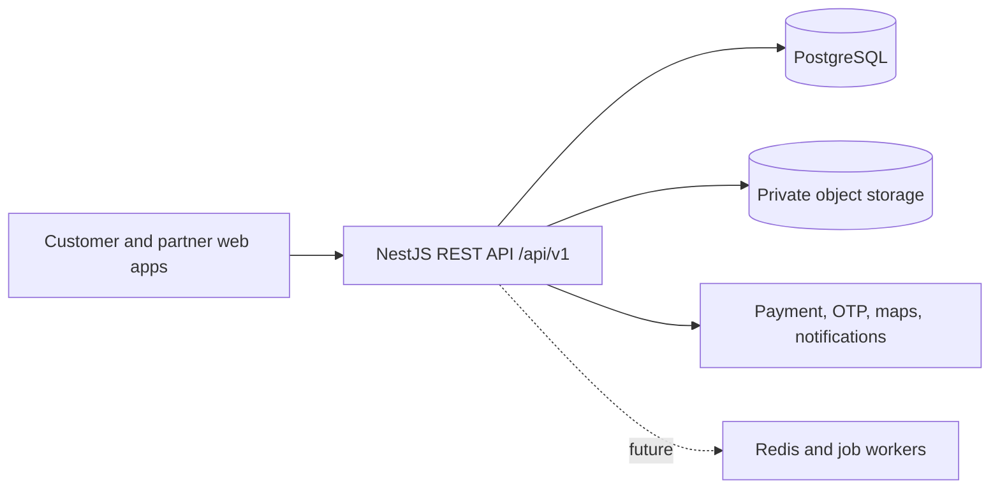

# System Architecture

The system is a modular monolith: one versioned NestJS API owns business rules and transactions, while independently deployable web portals consume its contracts. PostgreSQL is the source of truth; private S3-compatible storage holds documents; Redis and workers are introduced when asynchronous load requires them.

Module boundaries: identity, users, partners, catalogue, pricing, documents, orders, print, attestation, dispatch, payments, refunds, commissions, settlements, notifications, support, reviews, reporting and audit.

Cross-cutting rules: DTO validation at boundaries, explicit authorization guards, service-layer transactions, idempotency keys for mutations, structured logs with redaction, API versioning and OpenAPI documentation.
