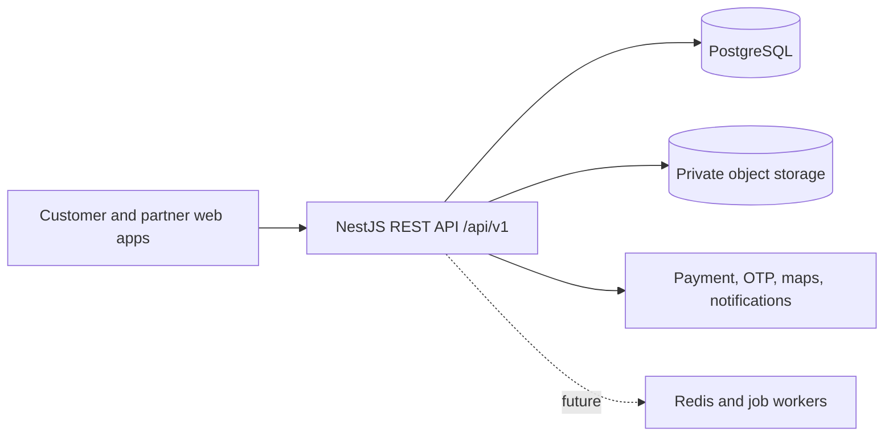

# System Architecture

The system is a modular monolith: one versioned NestJS API owns business rules and transactions, while independently deployable web portals consume its contracts. PostgreSQL is the source of truth; private S3-compatible storage holds documents; Redis and workers are introduced when asynchronous load requires them.

The API uses `S3_ENDPOINT` (optional for AWS S3), `S3_REGION`, `S3_BUCKET`, `S3_ACCESS_KEY_ID`, `S3_SECRET_ACCESS_KEY` and optional `S3_FORCE_PATH_STYLE`. Keep the bucket private, configure bucket CORS to allow `PUT` from the customer web origin with the `Content-Type` header, and configure a 30-day lifecycle rule for `private/customers/` objects. The API issues five-minute upload and preview URLs; shop preview URLs are scoped to a shop's own order.

Module boundaries: identity, users, partners, catalogue, pricing, documents, orders, print, attestation, dispatch, payments, refunds, commissions, settlements, notifications, support, reviews, reporting and audit.

Cross-cutting rules: DTO validation at boundaries, explicit authorization guards, service-layer transactions, idempotency keys for mutations, structured logs with redaction, API versioning and OpenAPI documentation.
