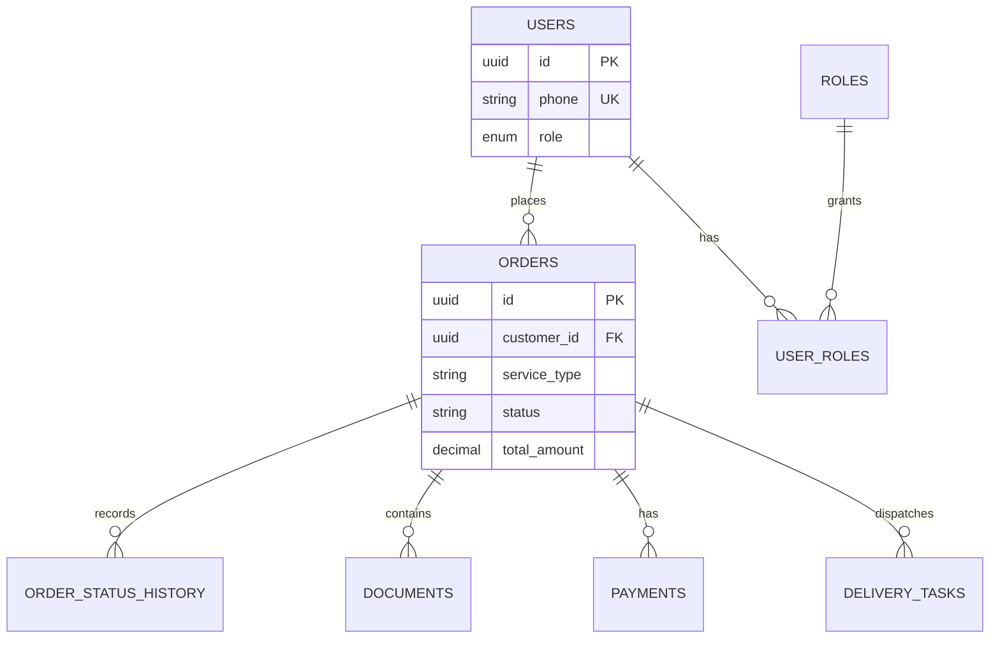

# Database and ER Diagram

The initial Prisma schema contains identity and order foundations. Domain modules should add tables through migrations rather than placing business state in JSON blobs.

Planned tables are grouped as identity, partners, catalogue, orders, documents, delivery, finance and operations. Use UUID primary keys, foreign keys, composite indexes for operational queries, decimal money values and append-only status/audit records.
