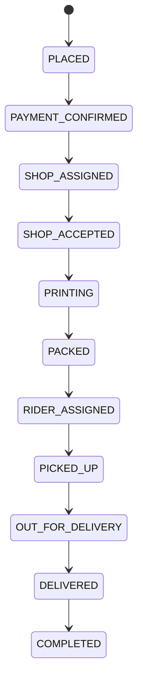

# Workflow Diagrams

## Print


## Attestation
```mermaid
stateDiagram-v2
  [*] --> PLACED --> PAYMENT_CONFIRMED --> PICKUP_SCHEDULED
  PICKUP_SCHEDULED --> COLLECTED --> AGENT_RECEIVED --> PROCESSING
  PROCESSING --> ATTESTED --> RETURN_SCHEDULED --> RETURN_PICKED_UP
  RETURN_PICKED_UP --> OUT_FOR_DELIVERY --> DELIVERED --> COMPLETED
```

Cancellation, failure, refund and dispute transitions are explicit commands, not arbitrary status updates. Each transition records actor, evidence and notification outcome.
